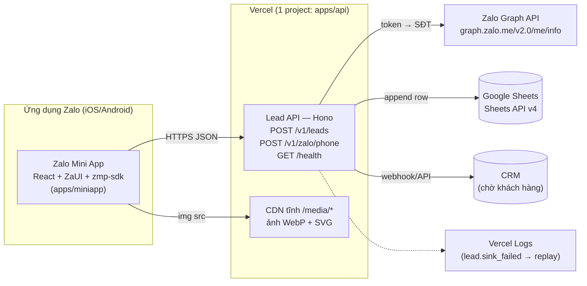
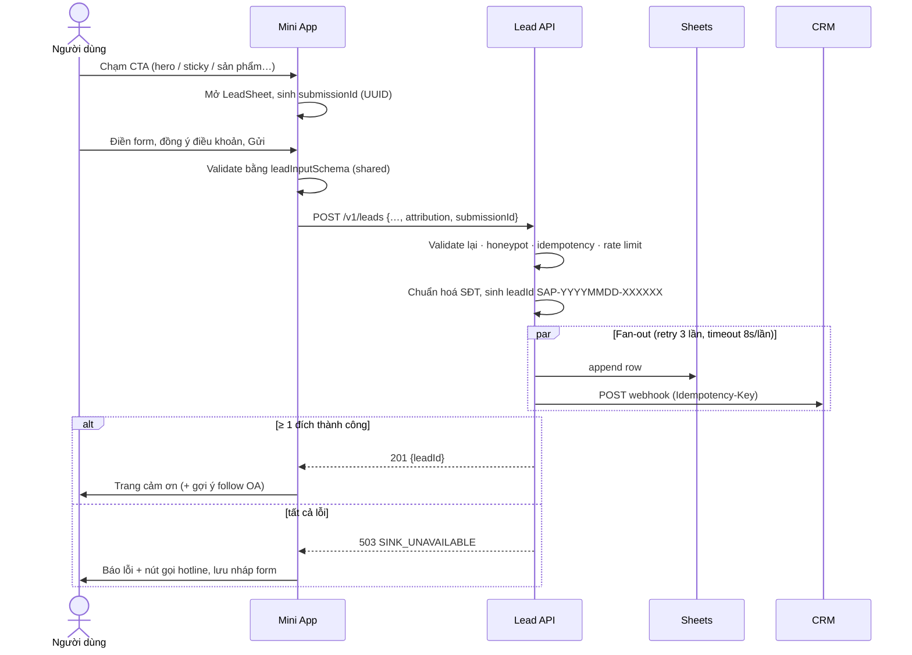
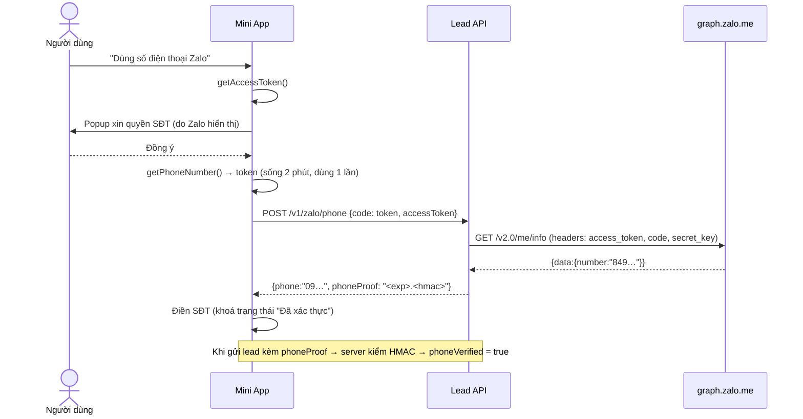

# 01 · Kiến trúc hệ thống

## 1. Sơ đồ tổng thể



**Nguyên tắc:**
1. **Mini App không giữ bí mật.** Mọi secret (Zalo App Secret, service account Google, khoá CRM) chỉ nằm ở Lead API.
2. **Mini App chỉ chứa code + UI**, không chứa ảnh nặng. Ảnh/video phục vụ từ CDN → gói nhỏ, mở nhanh, đổi ảnh không cần duyệt lại Mini App.
3. **Lead không được mất.** Fan-out song song, retry, idempotency, và log đầy đủ lead khi 1 đích lỗi để replay.
4. **Đích lưu trữ có thể thay thế.** CRM/Sheets là các `LeadSink` cắm-rút qua biến môi trường `LEAD_SINKS`.
5. **Một hợp đồng dữ liệu duy nhất** (`packages/shared`) — client và server cùng validate bằng 1 zod schema.

## 2. Thành phần

| Thành phần | Công nghệ | Vai trò |
|------------|-----------|---------|
| `apps/miniapp` | React 18, TypeScript, Vite 5, `zmp-ui` 1.11, `zmp-sdk` 2.x, Tailwind 3, `zmp-vite-plugin` | Giao diện landing + form lead chạy trong Zalo |
| `apps/api` | Node 20+, Hono 4, zod 4, `google-auth-library` | Nhận lead, xác thực SĐT Zalo, đẩy tới CRM/Sheets. Deploy Vercel Functions (Hono zero-config) |
| `packages/shared` | TypeScript, zod | Schema lead, kiểu API, chuẩn hoá SĐT — dùng chung 2 bên |
| `scripts/` | Node + sharp | Nén ảnh → CDN, kiểm tra dung lượng gói |
| `images/`, `script/`, `*.md` gốc | — | Tư liệu nguồn (chỉ đọc) |

## 3. Luồng chính

### 3.1 Gửi lead (nhập SĐT tay)



### 3.2 Lấy SĐT từ Zalo (xác thực)



Nếu người dùng sửa tay SĐT sau khi đã lấy từ Zalo → `phoneProof` bị huỷ → lead `phoneVerified = false`.

## 4. Cấu trúc repo

```
SA_ZALO-MINI-APP/
├─ apps/
│  ├─ miniapp/                     # Zalo Mini App
│  │  ├─ app-config.json           # cấu hình Zalo (title, statusBar, actionBar…)
│  │  ├─ vite.config.mts           # root=./src, output → apps/miniapp/www (zmp deploy đọc)
│  │  ├─ src/
│  │  │  ├─ app.tsx                # router + providers
│  │  │  ├─ config.ts              # biến môi trường, media(), hotline
│  │  │  ├─ content/               # NỘI DUNG (project.ts) + kiểu dữ liệu
│  │  │  ├─ sections/              # mỗi section landing 1 file
│  │  │  ├─ pages/                 # home, register, success, product, privacy
│  │  │  ├─ components/            # lead-form, lead-sheet, sticky-action-bar, ui
│  │  │  ├─ hooks/use-lead-form.ts # toàn bộ logic form
│  │  │  └─ lib/                   # api, zalo (bọc zmp-sdk), attribution, track
│  │  └─ test/                     # vitest (content ↔ CDN manifest…)
│  └─ api/                         # Lead API (Vercel)
│     ├─ src/
│     │  ├─ index.ts               # entry Vercel (export default app)
│     │  ├─ dev.ts                 # server local :8787 (+ phục vụ /media)
│     │  ├─ create-app.ts          # createApp(deps) — DI để test (KHÔNG đặt tên app.ts: Vercel nhận nhầm làm entry)
│     │  ├─ env.ts                 # schema biến môi trường
│     │  ├─ routes/                # leads.ts, zalo.ts
│     │  ├─ sinks/                 # console, sheets, crm-webhook, registry
│     │  └─ lib/                   # dispatch, rate-limit, idempotency, phone-proof, zalo, crypto, logger
│     ├─ public/media/             # (sinh tự động) ảnh WebP cho CDN
│     └─ test/
├─ packages/shared/                # schema lead + kiểu API + SĐT
├─ scripts/                        # optimize-assets.mjs, check-bundle-size.mjs
├─ docs/                           # tài liệu này
├─ images/  script/  Senturia-…md  # tư liệu nguồn (chỉ đọc)
└─ .github/workflows/ci.yml
```

## 5. Ranh giới & quy ước module

- **Section không gọi API, không gọi zmp-sdk trực tiếp.** CTA chỉ gọi `useOpenLeadSheet()(…)`; gọi điện/chat qua `lib/zalo.ts`.
- **Text hiển thị nằm trong `content/project.ts`**, không hard-code trong component (trừ nhãn UI chung).
- **Mọi lời gọi zmp-sdk** đi qua `lib/zalo.ts` (có fallback khi chạy ngoài Zalo).
- **Mọi request HTTP** đi qua `lib/api.ts`.
- **Thay đổi hợp đồng lead** = sửa `packages/shared/src/lead.ts` + cập nhật docs/03 + test hai phía.
- **Thêm đích lưu lead** = 1 class `LeadSink` mới + đăng ký trong `apps/api/src/sinks/index.ts` + `SINK_NAMES` trong `env.ts`.

## 6. Phi chức năng

| Hạng mục | Mục tiêu |
|----------|----------|
| Dung lượng gói Mini App | ≤ 3 MB (ngân sách nội bộ, kiểm bằng `pnpm assets:check`) |
| JS gzip | ≤ 250 KB (hiện ~173 KB) |
| Ảnh | WebP, ≤ 1080px rộng (mặt bằng 2000px), lazy-load trừ hero |
| API p95 | < 1,5 s cho `/v1/leads` khi các đích khoẻ |
| Khả dụng | Lead được nhận khi ≥ 1 đích còn sống |
| Trình duyệt | Webview Zalo trên Android ≥ 7, iOS ≥ 13 |
