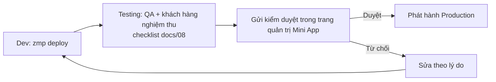

# 04 · Tích hợp Zalo Mini App

> Tài liệu chính thức: https://docs.zaloplatforms.com/docs/MA/ (Zalo for Developers). Mục đánh dấu **[VERIFY]** cần kiểm tra lại trên trang quản trị/tài liệu tại thời điểm triển khai — Zalo thay đổi chính sách theo thời gian.

## 1. Tài khoản & đăng ký (việc của khách hàng / PM — task OPS-01)

1. Tài khoản Zalo của pháp nhân (CĐT hoặc đại lý — câu hỏi Q5) đăng nhập **Zalo for Developers** → tạo **Ứng dụng** → lấy `App ID` và **App Secret Key** (mục *Quản lý ứng dụng*).
2. Tạo **Mini App** gắn với ứng dụng; xác thực thông tin doanh nghiệp nếu Zalo yêu cầu (cần để xin quyền SĐT). **[VERIFY]**
3. Liên kết **Zalo Official Account** (OA) của dự án → lấy `OA ID` (dùng cho `openChat`, `followOA`).
4. Thêm thành viên phát triển (tài khoản Zalo của dev/QA) để chạy bản Development/Testing.
5. Xin các quyền API cần dùng: **Lấy số điện thoại** (`getPhoneNumber`), **Thông tin người dùng** (`getUserInfo` — tuỳ chọn), **Theo dõi OA**. Mỗi quyền cần mô tả mục đích rõ ràng.

## 2. Cấu hình bắt buộc trong trang quản trị Mini App

| Mục | Giá trị | Ghi chú |
|-----|---------|---------|
| **Whitelist domain** (domain được phép gọi API / tải tài nguyên) | Domain Lead API (+CDN cùng domain), vd. `sa-api.vercel.app` | Không whitelist → `fetch` thất bại trong Zalo (lỗi giống mất mạng). **[VERIFY]** cả domain ảnh có cần whitelist không |
| Tên, icon, mô tả, danh mục | Theo nhận diện dự án | Dùng cho kiểm duyệt |
| Chính sách bảo mật | URL/trang `/privacy` | Bắt buộc khi xin quyền SĐT |

Biến môi trường tương ứng: `apps/miniapp/.env.*` → `VITE_API_BASE_URL`, `VITE_ASSET_BASE_URL`, `VITE_ZALO_OA_ID`; `apps/api/.env` → `ZALO_APP_ID`, `ZALO_APP_SECRET`, `CORS_ORIGINS`.

> **CORS:** webview Mini App gửi `Origin` riêng của Zalo. `.env.example` đang để `https://h5.zdn.vn, https://h5.zadn.vn` — **[VERIFY]** bằng cách xem log request đầu tiên trên bản Testing (API log header `origin`), rồi cập nhật `CORS_ORIGINS`.

## 3. API zmp-sdk dùng trong dự án

Tất cả bọc trong `apps/miniapp/src/lib/zalo.ts` (fallback khi chạy ngoài Zalo).

| API | Dùng ở | Ghi chú |
|-----|--------|---------|
| `getAccessToken()` | Lấy SĐT | Access token người dùng — gửi lên server, **không lưu** |
| `getPhoneNumber()` | Nút "Dùng số điện thoại Zalo" | Trả `token` sống **2 phút, dùng 1 lần**; SDK ≥ 2.13. Server đổi token qua `GET https://graph.zalo.me/v2.0/me/info` với headers `access_token`, `code`, `secret_key` |
| `getUserID()` | Gắn `zaloUserId` vào lead | Tuỳ chọn |
| `openPhone({phoneNumber})` | Gọi hotline | Fallback `tel:` |
| `openChat({type:"oa", id})` | Chat Zalo | Ẩn nút nếu chưa có OA ID |
| `followOA({id})` | Trang cảm ơn | Gợi ý nhận bảng giá qua OA |
| `getRouteParams()` | Attribution | Đọc UTM/ref khi mở từ link |

**Quy tắc kiểm duyệt về quyền SĐT** (theo tài liệu `getPhoneNumber`): chỉ xin khi người dùng chủ động bấm, giải thích mục đích ngay tại chỗ; luôn cho phép **nhập tay** thay thế. Ứng dụng xin quyền không rõ mục đích có thể bị từ chối (Điều 3.3.4 thoả thuận nhà phát triển).

## 4. Deep link & nguồn lead

| Mục đích | Link |
|----------|------|
| Mở landing | `https://zalo.me/s/<APP_ID>/` |
| Mở thẳng form | `https://zalo.me/s/<APP_ID>/register?entry=qr_event` **[VERIFY]** cú pháp path |
| Gắn UTM / mã sale | `…/?utm_source=zalo_oa&utm_medium=broadcast&utm_campaign=mo-ban-t10&ref=SALE01` |

Quy ước đặt tham số (để báo cáo thống nhất): `utm_source` ∈ {`zalo_oa`, `zalo_ads`, `qr`, `facebook`, `sale_share`, `event`}; `ref` = mã sale/CTV viết hoa không dấu.

## 5. Chạy, deploy, phát hành

```bash
# Local trong trình duyệt (SDK Zalo không hoạt động đầy đủ — dùng fallback)
pnpm dev:api          # http://localhost:8787
pnpm dev:miniapp      # http://localhost:3000

# Đăng nhập zmp-cli (1 lần, quét QR bằng Zalo)
pnpm --filter @sa/miniapp zmp:login

# Build + deploy
pnpm --filter @sa/miniapp build
pnpm --filter @sa/miniapp deploy:dev       # bản Development (thành viên dev mở bằng QR)
pnpm --filter @sa/miniapp deploy:testing   # bản Testing (QA/khách hàng nghiệm thu)
```

Quy trình phát hành:



- Mỗi lần đổi **code Mini App** → deploy + (với production) kiểm duyệt lại. Đổi **ảnh** (CDN) hoặc **logic API** → không cần duyệt lại.
- Thời gian kiểm duyệt: dự trù 1–3 ngày làm việc. **[VERIFY]**
- Tăng `version` trong `apps/miniapp/package.json` và `VITE_APP_VERSION` mỗi lần gửi duyệt.

## 6. Những lỗi thường gặp

| Triệu chứng | Nguyên nhân hay gặp | Cách xử lý |
|-------------|---------------------|-----------|
| `fetch` lỗi ngay trong Zalo, local chạy được | Domain chưa whitelist / CORS sai origin | Thêm domain vào whitelist; kiểm `CORS_ORIGINS` |
| Lấy SĐT báo lỗi 502 | Token quá 2 phút / đã dùng / sai App Secret / app chưa được cấp quyền SĐT | Gọi `getPhoneNumber` ngay trước khi gửi; kiểm `ZALO_APP_SECRET`; kiểm trạng thái quyền |
| Ảnh không hiện | Sai `VITE_ASSET_BASE_URL`, chưa chạy `pnpm assets:optimize` trước deploy API | Xem docs/06 §5 |
| Trắng màn hình | Lỗi JS khi import `zmp-sdk` ngoài Zalo hoặc route chưa khai báo | Mở bằng Zalo bản Development; kiểm `app.tsx` |
