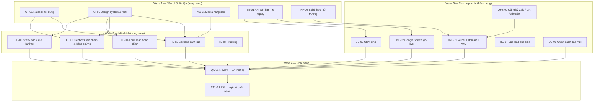

# 09 · Phân công task cho subagents

> Nền móng (kiến trúc, monorepo, Lead API, schema, pipeline ảnh, khung Mini App chạy được, CI, tài liệu) **đã xong**. File này chia phần còn lại thành các task độc lập để giao cho subagent chạy song song.

## 0. Luật chung cho mọi subagent

1. **Đọc trước khi làm:** `CLAUDE.md` → `docs/01-architecture.md` → phần docs ghi trong task.
2. **Chỉ sửa file thuộc quyền sở hữu của task** (cột "Sở hữu file"). Cần sửa file khác → ghi vào mục *Đề xuất ngoài phạm vi* trong báo cáo, không tự sửa.
3. **Không đổi hợp đồng lead** (`packages/shared`) trừ task được giao rõ.
4. **Text hiển thị lấy từ `content/project.ts`**; ảnh qua `MediaImage` / `media()`.
5. **Định nghĩa hoàn thành (DoD) chung:** `pnpm check` xanh · `pnpm --filter @sa/miniapp build` thành công · `pnpm assets:check` trong ngân sách · không còn `TODO(<task-id>)` của task mình · báo cáo ngắn: đã làm gì, file đã sửa, điều cần người quyết.
6. **Chạy trong worktree riêng** (`isolation: "worktree"`) khi song song; trưởng nhóm merge theo thứ tự wave.
7. Không commit secret; không gọi dịch vụ thật (Sheets/CRM/Zalo) trong test.

## 1. Tổng quan waves



## 2. Danh sách task

### Wave 1

#### CT-01 · Rà soát & hoàn thiện nội dung
- **Agent:** `general-purpose` · **Ước lượng:** S
- **Sở hữu file:** `apps/miniapp/src/content/**`
- **Đầu vào:** `Senturia-An-Phu_Tai-lieu-thong-nhat.md`, `script/**`, `apps/api/public/media/manifest.json`
- **Việc:**
  1. Đối chiếu từng chuỗi trong `project.ts` với tài liệu thống nhất (verbatim, ưu tiên nguồn B).
  2. Xem ảnh `tien-ich/bf-1.webp`, `bf-2.webp`, `phonggym.webp`, `sandanang.webp` (Read ảnh) để chốt nhãn tiện ích đúng với hình (mục 2.8 tài liệu).
  3. Bổ sung nội dung còn thiếu cần cho UI: tiêu đề/caption mặt bằng tổng thể, nhãn tab tiến độ, link Google Maps, tin tức (6 bài — chỉ dữ liệu, chưa làm UI).
  4. Đánh dấu rõ các mục chờ khách hàng (Q3, Q7) bằng comment `⚠️ Q<n>`.
- **DoD riêng:** test content xanh; danh sách khác biệt đã xử lý ghi trong báo cáo.

#### UI-01 · Design system, font, primitives & motion
- **Agent:** `general-purpose` (thực thi) → `ui-ux-designer` (review, chỉ đề xuất)
- **Sở hữu file:** `apps/miniapp/tailwind.config.js`, `apps/miniapp/src/styles/**`, `apps/miniapp/src/components/ui.tsx`, `apps/miniapp/src/hooks/use-reveal.ts` (mới), `apps/miniapp/src/components/icons.tsx` (mới)
- **Việc:**
  1. Tự host **Playfair Display** (400, 400 italic, 600) + **Be Vietnam Pro** (400, 500, 600) dạng woff2, subset `vietnamese,latin`, `font-display: swap`; tổng font ≤ 300 KB.
  2. Hoàn thiện token (docs/05 §2), thêm token bóng đổ, bo góc, khoảng cách section.
  3. Primitives: `Section`, `SectionHeading` (biến thể sáng/tối), `MediaImage` (khung `aspect`, nền skeleton, fade-in khi tải xong), `Button` CTA (primary vàng / outline / ghost), `Tag`.
  4. `useReveal()` — IntersectionObserver, thêm class khi vào khung nhìn; tôn trọng `prefers-reduced-motion`.
  5. Bộ icon SVG inline tối thiểu: phone, chat, arrow, close, check, map-pin, zoom.
- **DoD riêng:** trang `/` dùng primitives mới không vỡ; tài liệu token cập nhật trong docs/05 §2 (được phép sửa mục này).

#### AS-01 · Media nâng cao
- **Agent:** `general-purpose` · **Ước lượng:** S
- **Sở hữu file:** `scripts/optimize-assets.mjs`, `apps/miniapp/public/**` (icon app)
- **Việc:**
  1. Thêm biến thể nhỏ `@sm` (540px) cho ảnh dùng trong card/thumbnail; ghi vào manifest.
  2. Nếu máy có `ffmpeg`: nén `hero_kety.mp4` → ≤ 1,5 MB (720p, H.264, không tiếng) + poster WebP; nếu không, ghi rõ trong báo cáo.
  3. Tạo icon Mini App theo yêu cầu kích thước của Zalo **[VERIFY]** từ `header-logo` / `favicon`.
- **DoD riêng:** `pnpm assets:optimize --force` chạy sạch; tổng media không tăng quá 20%.

#### BE-01 · API vận hành: request-id, replay, health sâu
- **Agent:** `general-purpose` → `api-optimizer` (review)
- **Sở hữu file:** `apps/api/src/lib/**`, `apps/api/src/create-app.ts`, `apps/api/test/**`, `scripts/replay-lead.mjs` (mới)
- **Việc:**
  1. Middleware `x-request-id` (sinh nếu thiếu) → có trong mọi log + header response.
  2. `scripts/replay-lead.mjs`: đọc file JSON (các lead từ log `lead.sink_failed`) → gọi lại sink chỉ định bằng chính code sink của API (idempotent theo `submissionId`). Có `--dry-run`.
  3. `GET /health?deep=1` (bảo vệ bằng header token `HEALTH_TOKEN`): kiểm cấu hình từng sink (không ghi dữ liệu).
  4. Test cho các phần trên.
- **DoD riêng:** test mới xanh; docs/03 §6 cập nhật cách replay (được phép sửa mục này).

#### INF-02 · Build Mini App theo môi trường
- **Agent:** `general-purpose` · **Ước lượng:** XS
- **Sở hữu file:** `apps/miniapp/package.json` (scripts), `apps/miniapp/.env.*.example`, `apps/miniapp/vite.config.mts`
- **Việc:** `.env.staging.example`, `.env.production.example`; scripts `build:staging`, `build:production`, `deploy:testing` dùng build staging; in cảnh báo khi build production mà `VITE_API_BASE_URL` chứa `localhost`.

### Wave 2 (bắt đầu sau UI-01; FE-02/FE-03 sau CT-01)

#### FE-02 · Sections cảm xúc & thương hiệu
- **Agent:** `general-purpose` → `ui-ux-designer` (review)
- **Sở hữu file:** `src/sections/hero.tsx`, `overview.tsx`, `nature.tsx`, `legacy-design.tsx`, `partners-footer.tsx`
- **Việc:** theo docs/05 §3 hàng 1–5, 12–13: hero slider banner (5 ảnh mobile) **hoặc** video có poster (theo AS-01), số liệu đếm chạy, reveal khi cuộn, logo đối tác cân thị giác, footer có link `/privacy`.
- **Ràng buộc:** không thêm thư viện > 30 KB gzip; nếu cần carousel dùng `swiper` module tối thiểu và ghi lý do.

#### FE-03 · Sections sản phẩm & bằng chứng
- **Agent:** `general-purpose` → `ui-ux-designer` (review)
- **Sở hữu file:** `src/sections/floor-plans.tsx`, `amenities.tsx`, `location.tsx`, `progress-legal.tsx`, `src/pages/product.tsx`, `src/components/image-viewer.tsx` (mới)
- **Việc:** tab mặt bằng Tổng thể/Căn, xem ảnh phóng to (`ImageViewer` của zmp-ui), chạm mã căn → `useOpenLeadSheet()({entryPoint:"floorplan_<CODE>"})`; tiện ích carousel + chỉ báo; bản đồ 4 lớp SVG + nút mở Google Maps (`openWebview`/link ngoài qua `lib/zalo.ts` — đề xuất thêm hàm nếu cần); tiến độ 4 mốc dạng tab + ảnh; pháp lý dạng accordion; trang sản phẩm có viewer.

#### FE-04 · Form lead hoàn chỉnh
- **Agent:** `general-purpose`
- **Sở hữu file:** `src/components/lead-form.tsx`, `src/components/lead-sheet.tsx`, `src/hooks/use-lead-form.ts`, `src/pages/register.tsx`, `src/pages/success.tsx`, `apps/miniapp/test/lead-form.test.ts` (mới)
- **Việc:** hoàn thiện UX docs/05 §4 (giải thích ngắn tại nút lấy SĐT Zalo, khoá ô SĐT đã xác thực + nút "đổi số", cuộn tới ô lỗi đầu tiên, bàn phím số, trạng thái gửi), trang cảm ơn đẹp + follow OA, tách logic thuần (build payload, map lỗi) ra hàm để unit test.
- **Không được:** đổi schema shared (cần → đề xuất).

#### FE-05 · Sticky bar & điều hướng
- **Agent:** `general-purpose`
- **Sở hữu file:** `src/components/sticky-action-bar.tsx`, `src/pages/home.tsx`, `src/components/section-nav.tsx` (mới)
- **Việc:** icon + nhãn, ẩn khi đang ở hero và hiện khi cuộn qua, thanh mục lục nhỏ (chip cuộn tới section), cuộn mượt tới anchor trong `Page` của ZaUI.

#### FE-07 · Tracking hành vi
- **Agent:** `general-purpose`
- **Sở hữu file:** `src/lib/track.ts`, `src/hooks/use-section-view.ts` (mới)
- **Việc:** `view_section` qua IntersectionObserver (1 lần/section/phiên), gom sự kiện; đề xuất nơi nhận (GA4 Measurement Protocol qua API hoặc analytics của Zalo) — **chỉ đề xuất**, chưa tích hợp tới khi khách hàng chọn.

### Wave 3 (cần thông tin/tài khoản của khách hàng)

| ID | Task | Agent | Chặn bởi | Sở hữu file |
|----|------|-------|----------|-------------|
| INF-01 | Tạo project Vercel, env Preview/Production, domain, WAF rules, deploy lần đầu + kiểm **[VERIFY]** docs/06 §4 | `vercel:deployment-expert` | Tài khoản Vercel, Q8 | `apps/api/vercel.json` |
| BE-02 | Bật sink Sheets: tạo header, chạy thử staging, chốt cột với khách | `general-purpose` | Q2 (Sheet + service account) | `apps/api/src/sinks/sheets.ts` |
| BE-03 | Sink CRM thật (mapping, auth, chống trùng, test) | `general-purpose` → `api-optimizer` | Q1 (tài liệu CRM) | `apps/api/src/sinks/crm*.ts`, `apps/api/src/sinks/index.ts`, `apps/api/src/env.ts` |
| BE-04 | Báo lead mới cho sale (Zalo OA message / Telegram / email) như 1 sink | `general-purpose` | Q9 | `apps/api/src/sinks/notify-*.ts` |
| BE-06 | (Tuỳ chọn) Hàng đợi bền + idempotency KV (Vercel Queues / Upstash) | `general-purpose` (dùng skill `vercel:queues`) | Lưu lượng thực tế | `apps/api/src/lib/**` |
| LG-01 | Nội dung chính sách bảo mật chính thức, tăng `CONSENT_VERSION` | Người (pháp chế) + `general-purpose` nhập liệu | Q5 | `src/pages/privacy.tsx`, `packages/shared/src/lead.ts` (chỉ hằng số) |
| OPS-01 | Đăng ký app Zalo, Mini App, OA, quyền SĐT, whitelist domain, thành viên test | Người (PM/khách hàng) | — | — |

### Wave 4

| ID | Task | Agent |
|----|------|-------|
| QA-01 | `/code-review` toàn nhánh, `/security-review`, `code-improver` rà chất lượng; QA thiết bị theo docs/08 §3 (người thực hiện, agent tổng hợp lỗi) | `general-purpose`, `code-improver` |
| REL-01 | Tăng version, build production, `zmp deploy`, gửi kiểm duyệt, theo dõi phản hồi | Người + `general-purpose` |

## 3. Ma trận sở hữu file (chống xung đột khi chạy song song)

| File/thư mục | Wave 1 | Wave 2 |
|--------------|--------|--------|
| `src/content/**` | CT-01 | FE-02/FE-03 **chỉ được thêm field trong block section của mình** |
| `src/styles/**`, `tailwind.config.js`, `components/ui.tsx` | UI-01 | (khoá — đề xuất thay đổi qua báo cáo) |
| `src/sections/hero, overview, nature, legacy-design, partners-footer` | — | FE-02 |
| `src/sections/floor-plans, amenities, location, progress-legal`, `pages/product` | — | FE-03 |
| `components/lead-*`, `hooks/use-lead-form`, `pages/register|success` | — | FE-04 |
| `components/sticky-action-bar`, `pages/home` | — | FE-05 |
| `lib/track.ts` | — | FE-07 |
| `lib/zalo.ts`, `lib/api.ts`, `app.tsx`, `packages/shared/**` | **Trưởng nhóm** (nhận đề xuất, tự sửa) | Trưởng nhóm |
| `apps/api/src/lib/**`, `app.ts`, `test/**` | BE-01 | — |

## 4. Mẫu prompt giao task

```text
Bạn là subagent thực hiện task <ID> — <tên task> của dự án Zalo Mini App Senturia An Phú
(repo: D:\WORK\SA_ZALO-MINI-APP).

1. Đọc CLAUDE.md, docs/01-architecture.md, docs/09-task-breakdown.md mục <ID>, và <docs liên quan>.
2. Chỉ sửa các file thuộc "Sở hữu file" của task. Cần đổi file khác → ghi vào "Đề xuất ngoài phạm vi".
3. Thực hiện các bước trong mục "Việc". Giữ phong cách code hiện có (comment tiếng Việt ngắn, Biome format).
4. Trước khi báo xong: chạy `pnpm check`, `pnpm --filter @sa/miniapp build`, `pnpm assets:check` — dán kết quả.
5. Báo cáo (≤ 200 từ): đã làm gì · file đã sửa · kết quả lệnh kiểm tra · câu hỏi/đề xuất cho trưởng nhóm.
```

## 5. Trạng thái

| Task | Trạng thái |
|------|-----------|
| Nền móng (kiến trúc, repo, API, schema, ảnh, khung app, CI, docs) | ✅ Xong |
| Wave 1 | ⏳ Sẵn sàng giao |
| Wave 2 | ⏸ Chờ Wave 1 |
| Wave 3 | ⛔ Chờ khách hàng: Q1, Q2, Q5, Q8, Q9 + tài khoản Vercel/Zalo |
| Wave 4 | ⏸ |
